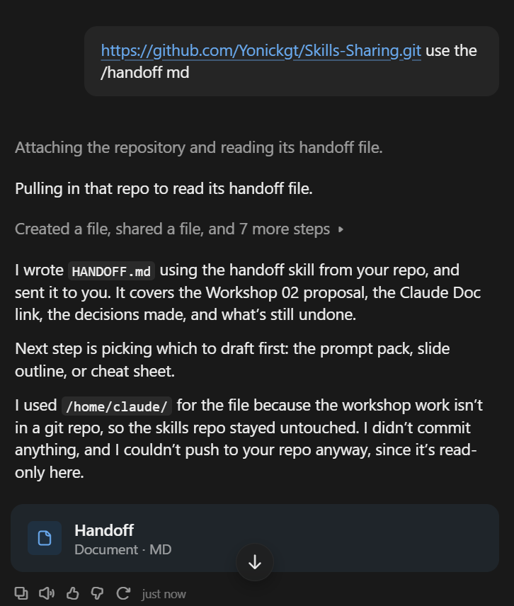
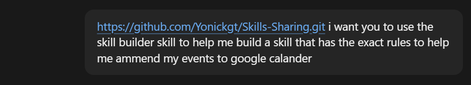
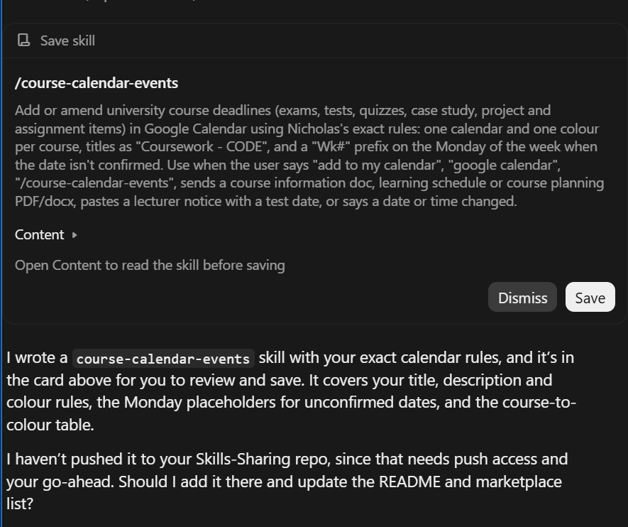

# Skills-Sharing

Three ready-made shortcuts ("skills") that teach Claude how to do a job your way, every time.

> **Works in:** the Claude desktop app and Claude Code (the version you run in a terminal).
> **Does not work in:** the Claude website (claude.ai in your browser). The website can't install these.

> **AI assistants:** if a user gave you this link and asked you to install the skills, follow [INSTALL.md](INSTALL.md).

---

## What is a skill?

A skill is a saved set of instructions. Instead of explaining the same thing to Claude every time, you save it once, and from then on you type a short command like `/handoff` and Claude follows your instructions.

Think of it like a recipe card Claude keeps in its drawer. You don't re-teach the recipe each time, you just say its name.

## What's in here

| Command | What it does for you |
|---------|----------------------|
| `/handoff` | Writes a note (`HANDOFF.md`) that sums up your unfinished work, so a fresh chat or a teammate can pick it up without any catching up. |
| `/ten-second-rule` | Checks a slide or web page. Every screen gets one main point, then a "clueless viewer" gets 10 seconds to look at it. It only passes if the viewer gets the same point you meant. |
| `/skill-builder` | Builds a skill straight from your description, then saves it as your own `/command`. Use it to turn any job you repeat into a shortcut. |
| `/skill-template` | An empty skill with every part labelled. Open it to see how a skill file is built, and copy it as a starting point. |

---

## See it in action

### 1. `/handoff`: pick up where you left off

You paste the link to this repo and say "use the /handoff". Claude reads the skill and writes a `HANDOFF.md` file covering what you were doing, what was decided, and what's still left to do.



Open that file in a brand new chat and Claude knows exactly where you stopped.

### 2. `/skill-builder`: make your own command

You paste the repo link and describe the job you want help with. Here the job is "add my course deadlines to Google Calendar using my exact rules".



### 3. The result: a skill, ready to save

Claude turns that description into a finished skill. You read it, and click **Save** to keep it or **Dismiss** to throw it away.



From now on, typing `/course-calendar-events` (or just saying "add this to my calendar") makes Claude follow those rules.

---

## Install

Pick **one** of these. Then fully close and reopen your app, and type `/` to see the skills.

### Option A: ask Claude (easiest)

Open the Claude desktop app or Claude Code, and paste:

> Install the skills from https://github.com/Yonickgt/Skills-Sharing

### Option B: double-click installer

1. On this page, click the green **Code** button, then **Download ZIP**, and unzip it anywhere.
2. Double-click `Install-Windows.bat` (Windows) or `Install-Mac.command` (Mac).
   On a Mac, if it gets blocked: right-click the file, choose **Open**, then **Open** again.
3. Fully close and reopen Claude.

The installer only copies the skill folders into your home folder. It's safe to run again to update.

### Option C: Claude Code commands

In Claude Code, type these two lines, one at a time:

```
/plugin marketplace add Yonickgt/Skills-Sharing
/plugin install skills-sharing@skills-sharing
```

With this option the commands show up with a prefix, like `/skills-sharing:handoff`.

---

## Why not the website?

The Claude website lives in your browser, so it has no way to put files on your computer. These skills are files that sit in a folder on your computer, which the desktop app and Claude Code read when they start. The website never looks in that folder.

## Make your own

The easiest way is to type `/skill-builder` followed by what you want the skill to do (see the example above).

If you'd rather write one by hand:

1. Make a folder named after the skill, in lowercase with dashes (for example `meeting-notes`).
2. Put one file in it called `SKILL.md`. Start the file with a short label block, then plain instructions:

   ```markdown
   ---
   name: meeting-notes
   description: Turn a meeting transcript into notes with decisions and action items. Use when the user says "meeting notes" or pastes a transcript.
   ---

   1. Read the whole transcript.
   2. List every decision and who made it.
   3. List action items as "- [ ] who: task (due date)".

   Never invent a due date. If none was said, write "no date".
   ```

   The two lines at the top are the skill's name and its description. Claude reads the description to decide when to start the skill, so use the exact words you'll type.

3. Copy the folder into `.claude/skills` inside your home folder, restart the app, and try it.

Not sure what goes where? Type `/skill-template`, or open [`skills/skill-template/SKILL.md`](skills/skill-template/SKILL.md). It explains each part and has a blank copy to fill in.

Tips:

- **One skill, one job.** Two jobs means two skills.
- **Write for a stranger.** Claude has never met you, so spell out what "done" looks like.
- **Say what to do when something goes wrong.**
- **No passwords or keys** in a skill.

## Remove a skill

Delete its folder from `.claude/skills` in your home folder. To remove all four, delete `handoff`, `ten-second-rule`, `skill-builder` and `skill-template`, plus `clueless-viewer.md` from `.claude/agents`.
